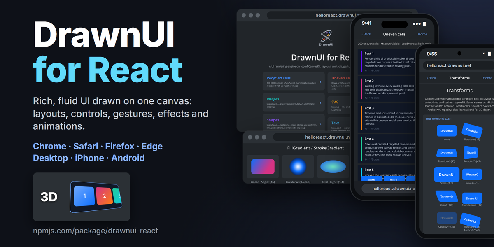

# DrawnUI for React



[](https://www.npmjs.com/package/drawnui-react)


Build rich, fluid UI for the web by drawing it. Every control is painted on one hardware-accelerated canvas by
DrawnUI, the Skia engine behind DrawnUI for .NET and Rust, and you compose it with React: JSX, hooks, state, the
way you already work.

Live demo: [helloreact.drawnui.net](https://helloreact.drawnui.net) · Playground: [drawfiddle.com](https://drawfiddle.com) · Docs: [drawnui.net](https://drawnui.net/articles/react/index.html)

```tsx
await Super.UseDrawnUi()
  .ConfigureFonts((fonts) => fonts.AddFont("fonts/OpenSans-Regular.ttf", "FontText"))
  .BuildAsync();

<Canvas BackgroundColor={Colors.DarkSlateBlue} RenderingMode="Accelerated" Gestures="Enabled">
  <SkiaStack Spacing={8} Padding={new Thickness(16)} VerticalOptions="Center">
    <SkiaLabel Text="Hello World" FontSize={32} TextColor={Colors.White} HorizontalOptions="Center" />
    <SkiaButton Text="Tap me" ApplyEffect="Ripple" HorizontalOptions="Center" Tapped={() => setCount((c) => c + 1)} />
  </SkiaStack>
</Canvas>
```

## One family

DrawnUI for React is the same engine as [DrawnUI for .NET](https://github.com/DrawnUi/DrawnUi.Net) (MAUI, Blazor,
WPF, OpenTK, WebAssembly) and [DrawnUI for Rust](https://github.com/DrawnUi/DrawnUi.Rust): the same controls,
property names, layout and drawing rules. What you learn here works there, and screens move between them.

## What you get, all drawn on one canvas

- **Layouts:** stacks, rows, grids, wrap and masonry, layers with any alignment.
- **Lists that stay smooth:** 100 000 recycled rows, items of different heights, load more at both ends.
- **Animations:** a frame loop for anything, Lottie and GIF, spritesheets.
- **Transforms in 2D and 3D:** rotate, scale, skew, perspective and depth; taps still land on the right control.
- **Gestures:** tap, long press, pan, swipe, drag to reorder, mouse hover, right-click menus.
- **Shaders:** SkSL effects on any control, shader transitions between images.
- **Navigation:** shell with pages, popups, modals, toasts, carousel and drawer.
- **Text:** rich spans, markdown, emoji and symbols, a drawn text editor.
- **Keyboard:** Tab, arrows, Enter and Escape move through every control, list, menu and dialog.
- **Accessibility:** screen readers read your drawn UI, names, values and dialogs included.
- **Games:** a game loop and sprites, with Pong as a sample.
- **AI-ready:** a [skill file](https://helloreact.drawnui.net/skills/drawnui-react/SKILL.md) teaches coding agents to build with it.

## MIT, everywhere

DrawnUI is MIT licensed in every language and on every platform: desktop, mobile, web and embedded devices. Ship it in commercial products with no attribution badge, no about screen and no per-device royalty.

## What's new in the next preview

- **`Super.OpenLink` and `UpdateNonStop()`:** open an address in a new tab, and keep a self-animating control (a
  time-driven shader, a clock) drawing every frame while it is shown, as in DrawnUi .NET.
- **Layout rules as in DrawnUI for .NET and Rust:** a Fill control with a size request keeps the requested size; a
  layer without a size of its own fits its sized children, and an empty Fill background takes that size; Center with
  unequal margins moves by the full margin difference.
- **Shader time:** `iTime` counts from the first shader frame, shared by every effect, so animated shaders stay smooth
  however long the page has been open.
- **Screen readers and opacity:** a control faded to opacity 0 is left out of the screen-reader tree, like a hidden one,
  and is read again when it shows.
- **Styles with code-behind:** a control built in code keeps every property the code set; a registered style fills in
  only the rest.
- **Nested scrolls:** a drag that starts on an inner list already at its end scrolls the page around it, so a page full
  of lists drags all the way to its end.
- **Paragraph spacing:** text with line breaks gets a quarter line between paragraphs by default (`ParagraphSpacing`
  0.25), as in DrawnUi .NET, and a growing editor (`AutoHeight`) fits each of its lines at its own height.
- **Line spacing from the font:** fonts with built-in leading keep it between lines (times `LineSpacing`), and
  `LineHeightUniform` gives every line of a label the tallest line's height.
- **Text placed as in DrawnUi .NET:** label lines are whole pixels high and text sits on the same baseline as in
  DrawnUi .NET; with `LineHeight` the extra space is shared above and below the text.
- **Sharp at any display scale:** the canvas matches the screen's device pixels exactly at fractional display scales,
  so text and lines stay crisp.
- **Moving inside a composite cache:** a control moved by its translation inside an `ImageComposite` layer draws at its
  new place right away.

## What's new in 0.1.0-preview.41

- **System light and dark:** `Canvas.SystemTheme` and `SystemThemeChanged` report the browser's light or dark appearance
  at start and on every change.
- **Designer actions:** `designerAction`, `useDesignerAction` and `<DesignerAction>` name app states the DrawnUI Designer
  can jump to.
- **Animations never stop each other:** an animation whose code fails is logged once, and the other animations and the
  frame keep going.
- **Quiet replaced animations:** a fade or move replaced by a new one is silent unless your code waits on it.

## What's new in 0.1.0-preview.40

- **Context menus from the keyboard:** the Menu key, Shift+F10 and a screen reader's context-menu command (VoiceOver
  VO+Shift+M) open the context menu of the control in keyboard focus, at its center, from that control or the first one
  above it with a `ContextMenu` handler, then the `Canvas` one; `e.Source` is `"keyboard"`. Controls with a context
  menu are reachable without a mouse.
- **Editor caret and the window:** a focused `SkiaEditor` keeps its focus while the browser window or tab is inactive,
  its caret hidden and still (no redraws); when the window gets the keyboard back the caret shows again in the same
  field. `Canvas.IsWindowActive` and `Canvas.WindowActiveChanged` tell your own controls the same.

## What's new in 0.1.0-preview.39

- **Tap feedback for the primary pointer:** tap and press animations (`AnimationTapped="Ripple"`, `SkiaButton`'s press
  ripple, a tappable span's ripple) play for a finger, a pen or the left mouse button. A right or middle click raises its
  events as before (`Tapped` with `Button` `"Right"`, `ContextMenu`) with no ripple. `SkiaControl.IsPrimaryPointer(args)`
  tells your own controls the same.

## What's new in 0.1.0-preview.38

- **SkiaScroll size, as in DrawnUI for .NET and Rust:** a `SkiaScroll` without a `WidthRequest` / `HeightRequest` that
  is not `Fill` on that axis sizes to its content on that axis, up to the space it is given. Set `HorizontalOptions` /
  `VerticalOptions` to `Fill` for a scroll that fills its space (a page scroll, a list).
- **Multi-touch:** a `Panning` while two or more fingers are down carries `Manipulation`: `Scale` (pinch), `Rotation`
  (turn, in degrees), `Center` / `PreviousCenter`, their totals and the finger count. A press that had a second finger
  down is no tap.
- **Keys, one order everywhere:** the canvas keyboard navigation (activation, arrows in lists and menus, slider steps,
  Escape closing a popup window) gets each key first, then your `KeyboardManager` handlers run with
  `KeyboardManager.IsKeyHandled` telling whether navigation used it. Skip handled keys so one press does one thing.
- **Desktop menu bars from the keyboard:** Alt alone puts the keyboard on the bar, the arrows go round the titles and
  the lines, Escape closes one level. New for your own menus: `KeyboardWrap` (the arrows go round a group),
  `canvas.SetAccessibilityFocus(control)` (it wins over the canvas' own focus move of the same frame; `undefined`
  keeps the focus where it is), `canvas.KeyboardFocusNode`, `AccessibilityExpanded`.
- **Frame players:** `SpeedRatio` is the real speed (0.5 plays at half speed, 2 at double) on `SkiaSprite`, `SkiaGif`
  and `SkiaLottie`. `DefaultFrame` and `CurrentFrame` are frame indexes, -1 is the last frame.
- **Images:** `Aspect="Tile"` repeats a `SkiaImage` or `SkiaSvg` at its natural size over the whole control, starting
  from the copy its alignment places. `AddEffect="Grayscale"` uses the 0.21 / 0.72 / 0.07 luminance weights;
  `BlackAndWhite` keeps 0.2989 / 0.587 / 0.114.
- **Gradients:** a gradient's `Light` above 1 multiplies each color's lightness, below 1 its red, green and blue, as in
  DrawnUI for .NET. A `SkiaLabel` with a `BackgroundColor` takes its `FillGradient` on the background and keeps its
  `TextColor`; without one the gradient fills the text.
- **Drawers:** `AutoClose` closes on a press outside the drawer's content, so a full-screen drawer with a smaller panel
  closes from a press above the panel. A touch that lands on a drawer while it slides lets it finish the slide.
- **Shell modals:** `ModalsCount`, `CanGoBack` and `Navigated` (Pop) follow a modal the moment its close starts,
  whether by `PopModalAsync`, a swipe or `IsOpen = false`; the modal slides out after that.
- **Carousels:** a second swipe during a shader carousel's transition raises `Stopped` once, at rest, and a move by
  code takes over a queued swipe. `IsUserFocused` is false after every release, a tap included.
- **Removed controls:** a control removed from the canvas pauses its animations until it is added back; a disposed
  one stops them. A removed text field lets go of the keyboard, and a `DrawnGame` gets keys while it is on a canvas.
- **Accessibility:** shell popups and modals read as dialogs, a live region's new text is read on the next frame, and
  a menu or list whose items sit in several layouts is walked in reading order.
- **Tools:** `Canvas.PopupWindowRoots` lists the open popup windows, `Canvas.WasDrawnListeners` runs handlers after
  every drawn frame, and `DesignerSourceOf(control)` gives the React element that created a control in dev builds.

## Install

```
npm i drawnui-react react react-dom
```

`drawnui-react` = React tags + every engine type, `drawnui-react/core` = the engine only. Ships ES modules + `.d.ts`;
CanvasKit's `.wasm` is referenced with a `?url` import, so use Vite (or any bundler that understands `?url`) and
put your fonts under `public/fonts`. Preview releases carry the `preview` dist-tag (the first publish also became `latest`, as npm always does).

## Run

```
npm install
npm run dev              # samples/demo at http://localhost:5173
npx vite samples/<name>  # any other sample
npm run build            # typecheck + build all samples into dist/<name>/
```

## Skills for AI agents

`skills/drawnui-react/SKILL.md` teaches an agent this library (install, startup, composition rules, scroll / shell
extras, caching, effects, accessibility). Save it under `~/.claude/skills/drawnui-react/SKILL.md` or fetch it from
the demo site: https://helloreact.drawnui.net/skills/drawnui-react/SKILL.md — `llms.txt` / `llms-full.txt` at the
site root point to it. Pair it with the DrawnUI framework skill from https://drawnui.net/llms.txt.

## Where React ends and DrawnUi begins

React never touches the canvas. The engine (`src/core`, `src/controls`) is plain TypeScript: `SkiaControl` trees
that measure, arrange and paint themselves on a CanvasKit surface, exactly like the .NET `SkiaControl` trees — it can
be driven from any framework, or from no framework at all (`new SkiaLabel()`, `AddSubView`, `canvas.Content = ...`).

`react-reconciler` is React's own renderer-building package: the same core that powers `react-dom` and
`react-native`, minus the DOM. You hand it a "host config" — how to create an instance for a JSX tag, how to append
/ remove / reorder children, how to apply changed props — and React does the rest: diffing, hooks, state, effects,
keys, Suspense. Our host config (`src/react/reconciler.ts`) maps every tag to an engine class (`<SkiaLabel>` →
`new SkiaLabel()`), `appendChild` to `AddSubView`, and a changed prop to a plain property assignment on the control
(`Text`, `FontSize`, `Tapped`…), after which the control invalidates itself the way it would from C#. So the JSX is
just a declarative way to build and mutate the same control tree; the render loop, caching, gestures, animators and
accessibility all live in the engine and would work identically under Vue, Svelte, Blazor-JS interop or a game loop.
That is also why the demo pages describe DrawnUi features, not React ones: the same pages are meant to be reused as
the showcase for other frameworks on this engine.

## Games

`DrawnGame` (from DrawnUi.Gaming) is ported: a layout with a game loop. Subclass it, build your sprites in the
constructor, call `StartLoop()`, and override `GameLoop(deltaSeconds)` and `OnKeyDown` / `OnKeyUp` (DOM `event.code`
names). Move sprites with `Left` / `Top` on cached controls, as in C#. The demo's `#/pong` page is the .NET Pong
sample (`src/Shared/Samples/Pong.Shared`) ported line for line: the game classes are plain TypeScript in
`samples/demo/pages/pong`, mounted from `PongPage.tsx` with `AddSubView`, and a small `RescalingLayout` fits the
360×640 field to any screen by changing the children's rendering scale.

## Context menu (right click)

A right click on the canvas normally opens the browser's own menu ("Save image as…"). Every mouse button goes
through the gesture pipeline as in DrawnUi.Net (`e.Parameters.Event.Pointer.Button` says which), so a right click is
a `Tapped` with `Button` `"Right"` for games and custom controls; a handler that should act on the primary button only
checks it. To take the browser menu request, handle `ContextMenu` on any control, exactly like `Tapped`:

```tsx
<SkiaShape Tapped={(s, e) => { if ((e.Parameters.Event.Pointer?.Button ?? "Left") === "Left") open(); }} />
<SkiaShape ContextMenu={(sender, e) => { openMyMenu(e.Location); return true; }} />
<Canvas ContextMenu={(canvas, e) => true /* nothing hit: swallow the browser menu everywhere */} />
```

The request is routed like a tap: deepest visible control under the point first (through transforms), then its
parents, then the `Canvas` prop. The first handler returning `true` takes it and the browser menu is suppressed;
with no handler the browser menu shows as before. `e` carries `Location` (points on the canvas), `Pixels`, `Local`
(pixels inside the handling control), `Source` (`"mouse"`, `"touch"` for a long press, `"keyboard"` for the Menu
key or Shift+F10 on the control in keyboard focus, opened at its center) and `Native` (the DOM event, for modifiers). Web-only: DrawnUi.Net has no mouse buttons.

## Menu bar

A desktop menu bar is a row of titles (`Aria.RoleMenuBar`), each opening its menu below it with
`OpenPopupWindow(canvas, menu, title)`. The demo's menu bar works the way desktop users expect, from the mouse and from
the keyboard alone: a click opens a menu and the mouse over another title opens that one; Alt alone puts the keyboard
on the bar and Alt+F opens File; Left / Right go round the titles, Down, Enter or Space open one on its first item; Up /
Down / Home / End go round its lines, Right / Left move to the next / previous menu, Enter runs the line, Escape closes
one level and Alt leaves, giving the keyboard back. The keyboard's place shows the selected look in the accent color,
the hover keeps its lighter look. Screen readers hear menubar, menu and menu item roles, the titles' expanded state
(`AccessibilityExpanded`) and every line the keys light (`canvas.SetAccessibilityFocus(control)`). Shortcuts (Ctrl+S,
F1) work with the menus closed too. Code: `samples/demo/pages/MenusPage.tsx`.

## Accessibility

Same model as DrawnUI for .NET in the browser: the `<canvas>` is `aria-hidden`, and an invisible ARIA layer mirrors
every accessible drawn control (role, name, hint, value, pressed state, live regions). Tab, the arrow keys, Home /
End, PageUp / PageDown, Enter, Space and Escape move through controls, lists, menus and dialogs; screen-reader
activation reaches the control as a `Tapped`. A dialog marked `AccessibilityModal` (shell popups and modals are by
themselves) keeps readers and the keyboard inside it, and a live region's new text is read on the next frame.

Per control (C# names): `AccessibilityRole` (enables the node; use `Aria.*`), `AccessibilityLabel`
(defaults to the control's text), `AccessibilityHint`, `AccessibilityCanInteract` (defaults to "has a
`Tapped` handler"), `AccessibilityIsPressed`, `AccessibilityExpanded`, `AccessibilityLive`, `KeyboardWrap` (the arrows
go round a group); `canvas.SetAccessibilityFocus(control)` moves the keyboard and screen-reader focus from app code.
The canvas navigation gets every key first, then `KeyboardManager` subscribers run with `KeyboardManager.IsKeyHandled`
telling whether navigation used it, so one press does one thing. `Aria.RolePresentation` hides a control that
would otherwise get a default role.

App-wide opt-in (React extension): `SkiaLabel.DefaultAccessibilityRole = Aria.RoleText` and
`SkiaButton.DefaultAccessibilityRole = Aria.RoleButton` (import the classes from `drawnui-react/core`) make every
label readable and every button focusable without touching each control.

The overlay has `pointer-events: none`, so hover and all pointer gestures still reach the canvas — the
Blazor "accessible control loses hover" limitation does not apply.

Text selection (React extension, opt-in): `AccessibilityTextSelectable` on a `SkiaLabel` renders its laid-out lines
as real, invisible DOM text in the overlay — one span per drawn line, in the same font (registered fonts are also
installed as CSS `FontFace`s) and stretched to the drawn line width — with pointer events on. The browser then
selects, copies (Ctrl+C / context menu) and reads it like an HTML paragraph, and the wheel over it still scrolls the
drawn content. It is off by default and must stay off on anything gesture-driven (buttons, carousels, drawers): the
selectable text owns the pointer, so taps and pans under it never reach the drawn control. Everything else in the
overlay is `user-select: none`, so select-all only highlights opted-in text.

## Crawlers and AI agents: static HTML from the accessibility tree

A drawn app serves `<div id="root"></div>`; a crawler that does not run JavaScript sees nothing. The
`drawnUiStatic` Vite plugin fixes that at build time, from the app itself:

```ts
// vite.config.ts
import { drawnUiStatic } from "drawnui-react/vite";
export default defineConfig({ plugins: [react(), drawnUiStatic()] });
```

After `vite build` it serves the build, opens it in headless Chrome (`playwright-core`, your dev dependency; GitHub's
ubuntu runners ship a Chrome), lets the engine draw, reads the accessibility snapshot of the root page and of every
page a root button opens (or the `routes` you list), and writes ordinary visible HTML into `dist/index.html`: a
heading is a heading, a button is a link to the page it opened, a label is a paragraph. The overlay's own markup
(transparent text over the canvas) is never copied — in a static file it would read as hidden text. Nothing is
hand-written, so it cannot drift from what the canvas draws.

Where it lands: right after the mount element (`#root`), or wherever you put `<!-- drawnui-static -->` in
`index.html`. With the mount element filling the viewport that is below the fold: a visitor sees the app area
loading, the text is a scroll away, genuinely visible, nothing collapsed or hidden. The first `<Canvas>` that mounts
removes it once its engine has drawn frame 1 (one `querySelectorAll`, nothing in the frame loop, nothing to pay for
an app built without the plugin). If the app never boots it stays. The mount element keeps its size, so nothing
above the fold moves; a page that scrolled only because of the block loses its scrollbar (classic scrollbars give
the canvas those ~15 px back — `html { scrollbar-gutter: stable }` keeps the gutter if you prefer). If the mount
element is a box inside a longer page, put the marker at the end of the body so your own content does not move.
Look: a default stylesheet ships with the block (inherits your `body` font and color, translucent surfaces); override
by styling `.drawnui-static` or pass `render: { style: false }`.

Two things to know. Check it with `curl` or view-source, not DevTools after boot. And crawlers that do not run
JavaScript (GPTBot, ClaudeBot, CCBot, link previews) read this HTML, while Googlebot renders JavaScript and sees the
booted page, i.e. the accessibility overlay; both come from the same tree, and a control without an
`AccessibilityRole` is invisible to both.

## Development

Repo layout, build scripts, skill sync and how the demo / npm package are published: [dev/DEVELOPMENT.md](dev/DEVELOPMENT.md).
