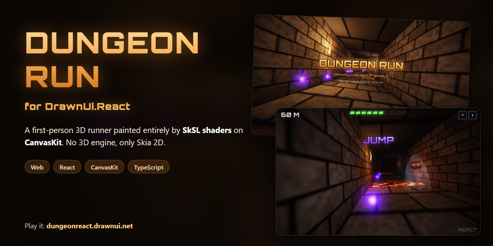

# Dungeon Run for DrawnUi.React

Dungeon Run is a first-person dungeon runner you play in the browser. It is the
[DrawnUI for Rust example](https://run.drawnui.net) built with DrawnUi.React: the same game and the same look, with
no 3D API, only Skia 2D on CanvasKit (Skia compiled to WebAssembly), written in TypeScript.

Play it: [dungeonreact.drawnui.net](https://dungeonreact.drawnui.net).

This demo shows a full 3D world painted by SkSL shaders in a web app. One triangle list carries the scene (floor,
walls, pillars, sprites) and tells each pixel which surface it is on; the shaders do all the painting.

## How it's built

All the shaders are the game's own SkSL, shared word for word with the Rust and .NET versions, in
`src/game/shaders.ts`. CanvasKit compiles them at run time (`RuntimeEffect`) and runs them on the GPU.

- `MESH_FS` is the dungeon itself: ten materials (floor, ceiling, wall, lava, rune pillar, orb, flame, beam and two
  power-ups), procedural bricks with bevels, flickering torches, fog, glowing runes, the lava, and the daylight and sky
  behind the exit.
- `POST` adds the effects over the whole picture: color fringes and a vignette at the edges, grain, the red of a hit,
  the orb pickup pulse, the health and shield auras, the surge rays and the ghost's blackout.
- `GLOW`, `CURTAIN` and `DIALOG` draw the glowing titles, the GAME OVER burn and the dialog panels.

Every frame (`src/game/scene.ts`), every visible quad is clipped at the near plane and projected to the screen on the
CPU, and all of it goes into one draw. CanvasKit has no mesh API, so `src/game/mesh.ts` draws that triangle list
with `drawVertices` and one runtime shader that is `MESH_FS` with a small entry point in front of it: each triangle
gets its own cell of texture coordinates, its corners' values (world position, texture position, material, lava
glow, normal, a random seed) are written into a half-float image, and each pixel reads its triangle's three corners
and blends them, perspective-correct, before `MESH_FS` paints it.

Everything around the scene is ordinary DrawnUi.React: the HUD, the texts, the help and pause dialogs, a shell for
them, and the screen-reader and keyboard support. The game's tree is built with the engine API
(`src/app/DungeonApp.ts`) and mounted into a `<Canvas>` (`src/main.tsx`).

On high-density screens the scene and its post effect draw at most 1.33 pixels per point and are scaled up to the
screen with linear filtering, while the HUD, the texts and the dialogs stay at full resolution. `?maxdensity=2`
changes it for tries (`?maxdensity=0` turns it off).

## How to play

You run forward by yourself. Stay alive as long as you can.

| Action                 | Keyboard                                    | Touch                                |
| ---------------------- | ------------------------------------------- | ------------------------------------ |
| Start                  | Space, Enter                                | Tap                                  |
| Change lane            | Left / Right, A / D (hold to keep moving)   | Drag left or right (finger or mouse) |
| Jump                   | Up, W, Space                                | Tap or click anywhere                |
| Help                   | F1 (a browser may keep F1 for its own help) | The ? button                         |
| Pause (home or resume) | P, Escape                                   | The II button                        |

- **Rune pillars**: change lane.
- **Red beam** and **lava**: jump.
- **Orbs**: a little health each. The third of a row taken without a miss counts double.
- **Ghost**: far away only its eyes burn; up close it lunges and takes three tenths of your health. Change lane.
- **Green cross**: health back. **Surge** (cyan arrows): four seconds much faster, nothing hurts you. **Shield**
  (golden): the next pillar or ghost costs nothing.
- **The distance is the score.** The dungeon ends at 3000 m, at a doorway into daylight: out of it, YOU ESCAPED!
- Running wears you down, so the orbs are what keeps you going. The run gets faster with distance.

## Run it

From the repository's root, with Node.js 20 or newer:

```
npm install
npx vite samples/dungeon
```

Then open the address Vite prints (http://localhost:5173 by default).

A production build into `dist/dungeon`:

```
npx vite build samples/dungeon
```

The tests of the rules of the run (no browser needed):

```
node dev/check.mjs samples/dungeon/tests/check-world.ts
```

## Project layout

- `src/game`: the game without UI: the rules (`world.ts`), the scene (`scene.ts`), the mesh drawing (`mesh.ts`) and
  the SkSL (`shaders.ts`).
- `src/app`: the screens around it, built with the DrawnUi.React engine API: the HUD, the title, the dialogs.
- `src/main.tsx`: the page: fonts, the `<Canvas>`, the loading screen (`src/loader.ts`).
- `public`: fonts, favicon and the site's files.
- `tests`: the Node check of the rules.
